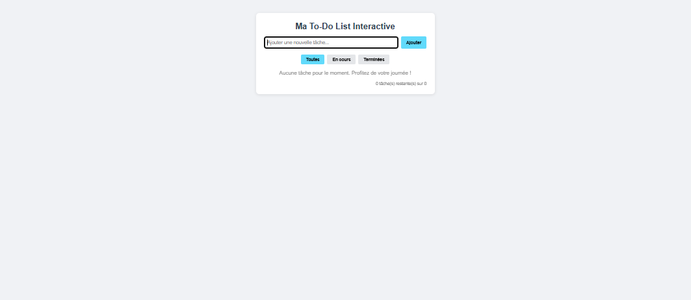
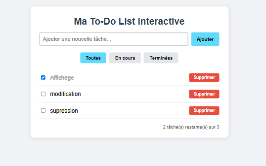
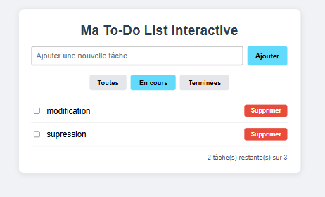
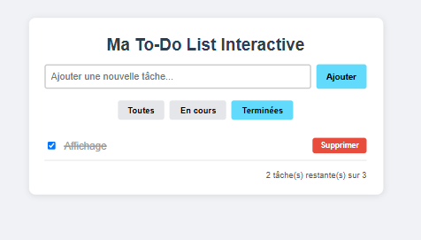

# TP4 React : Projet de synthèse React – To-Do List interactive ou Blog simple

Pour ce projet de synthèse j'ai choisi l'option A, la To-Do List. Elle regroupe ce qu'on a vu avant : composants, `useState`, événements et props.

## Lancer le projet

```
npx create-react-app mon-projet-react
cd mon-projet-react
npm start
```

Ensuite j'ai remplacé le contenu du dossier `src/` par mes fichiers. L'application tourne sur `http://localhost:3000`.

## Fonctionnalités

- Ajouter une tâche avec un formulaire (un texte vide est refusé).
- Afficher la liste des tâches.
- Cocher ou décocher une tâche, elle est alors barrée.
- Supprimer une tâche.
- Un message s'affiche quand la liste est vide.

Comme bonus j'ai ajouté :
- les filtres Toutes, En cours et Terminées ;
- la sauvegarde avec `localStorage`, donc les tâches restent après un rechargement de la page ;
- un compteur du nombre de tâches restantes.

## Organisation

```
src/
├── components/
│   ├── TodoForm.js
│   ├── TodoItem.js
│   └── TodoList.js
├── App.css
├── App.js
├── index.css
└── index.js
```

- `TodoForm` gère le champ de saisie avec un état local et appelle `ajouterTache` à la soumission.
- `TodoList` parcourt le tableau avec `map()` et affiche un `TodoItem` par tâche.
- `TodoItem` affiche une ligne avec la case à cocher et le bouton Supprimer.
- `App` contient l'état global (les tâches et le filtre) et les trois fonctions : `ajouterTache`, `changerEtat` et `supprimerTache`. Elles sont passées aux composants enfants par les props.

## Tests

J'ai testé le champ vide, l'ajout de plusieurs tâches, la suppression, le changement d'état, les trois filtres et le rechargement de la page (les tâches sont bien conservées). Je n'ai pas d'erreur dans la console du navigateur.

## Captures d'écran

Liste vide au départ, avec le message d'information :



Liste avec trois tâches, dont une terminée (barrée) :



Filtre "En cours" : seules les tâches non terminées sont affichées :



Filtre "Terminées" : seule la tâche cochée est affichée :


